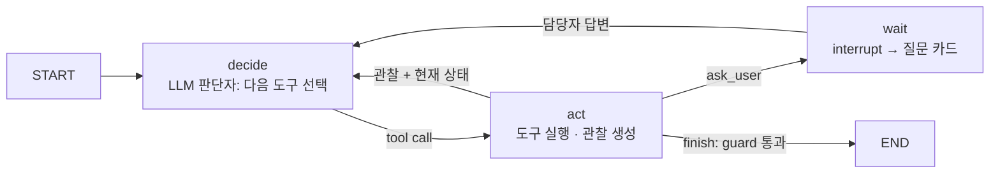

# cost-agent — IDC 청구서 원가 매핑 에이전트

담당자가 IDC 청구서 엑셀을 보고 원가 항목을 손으로 옮겨 적던 일을 대신한다.
양식이 사업자마다 달라도 **AI가 각 줄을 원가 항목에 매핑**하고, **코드가 총액·누락을 검증**한 뒤,
**GPUAU/BE 원가 계산 API**로 제안가까지 계산한다.

> 1차 범위(MVP): 청구서 매핑 → 검증 → 담당자 확인 → 템플릿 저장 → BE 원가 계산.
> 견적서 내보내기, 가격 변동 알림은 다음 단계.

## 1. 왜 AI가 필요한가

양식이 하나뿐이면 규칙 파서로 충분하다. AI가 필요한 이유는 **양식을 미리 알 수 없기 때문**이다.

| 문제 | 예 |
| --- | --- |
| 같은 항목인데 이름이 다름 | 전력 사용료 · 동력비 · Power · kWh 요금 |
| 표 구조가 다름 | 시트 여러 개, 요약/상세 분리, 항목이 행 또는 열 |
| 한 줄에 여러 항목이 묶임 | `Colocation - Power 40kW included` |
| 새 양식이 계속 생김 | 사업자 추가, 양식 개편 |

그래서 **처음 보는 양식만 AI**가 매핑하고, 담당자가 확인한 결과는 **템플릿**으로 저장해 다음부터는 AI 없이 처리한다.

## 2. 처리 흐름

```
엑셀 업로드 (POST /v1/bills)
  │
  ├─ 양식 지문(fingerprint)으로 저장된 템플릿 조회
  │     있음 → 템플릿 적용 (AI 호출 없음)
  │     없음 → LLM 매퍼 (키 없거나 실패 → 키워드 규칙 매퍼)
  │
  ├─ 금액 읽기: LLM은 "몇 번째 칸이 금액인지"만 답하고, 숫자는 코드가 그 칸에서 읽는다
  │
  ├─ 코드 검증
  │     · 총액 대조: 원가 합계 (− 할인) (+ 부가세) = 청구 총액/공급가액
  │     · 큰 항목 누락: 전력 · 공간·상면 · 네트워크 · 운영·유지보수
  │     · 확신도 낮은 줄, '기타' 비중 과다, 금액 없는 줄
  │
  ├─ BE 형식으로 합치기
  │     · 같은 항목 합산 (BE는 항목 중복 불가)
  │     · 월 청구 ×12 → 연간 (BE 기본 프로필은 MONTH 불가)
  │     · 1회성 비용 → 취득비(ACQUISITION)
  │     · 묶인 항목 → INCLUDED_IN_OTHER
  │
담당자 확인·수정 (PUT /v1/bills/{id}/lines) → 오류가 없으면 템플릿 저장
  │
원가 계산 (POST /v1/bills/{id}/simulate) → BE /api/v1/cost-simulations
      청구서에 없는 값(GPU 수, 취득비, 감가상각, 가동률, 마진)은 담당자 입력
```

**민감정보 보호**: LLM에는 항목명만 보낸다. 금액 칸은 `#NUM`, 글자 속 숫자는 `#`, 이메일·URL·`SENSITIVE_TERMS`는 가리고 파일명은 보내지 않는다.
청구 기간(월/연)은 가리기 전 원문에서 코드가 판단한다. 실제로 보낸 내용은 응답의 `llm.sent`로 담당자에게 그대로 보여 준다.
외부 전송 자체가 안 되면 `OPENAI_BASE_URL`로 사내 sLLM을 쓰거나, 확정 템플릿만으로 처리한다.

**원칙**: 숫자는 코드가 읽고 BE가 계산한다. LLM은 분류와 설명만 맡는다. 같은 입력이면 같은 결과가 나와야 한다.

## 3. 원가 에이전트 (LangGraph, `/v1/agent`)

목표 "청구서 한 장 → 근거 있는 제안가와 견적 근거서"를 향해 **LLM 판단자가 다음 행동(도구)을 고르고**, 결과를 보고 다시 고른다.
숫자는 도구와 BE가 계산하고, 판단자에게는 금액·식별자 없이 상태와 상대값만 보낸다.



| 도구 | 하는 일 | 전제 조건 (안 맞으면 '실행 불가'와 이유를 돌려줌) |
| --- | --- | --- |
| `analyze_bill` | 분류(숫자 가림) · 규칙 교차 확인 · 총액 대조 · 누락 탐지 | 아직 분석 전 |
| `remap_bill(hypothesis)` | 판단자의 원인 가설을 붙여 재분류 | 총액 불일치, 최대 2회 |
| `ask_user(kind)` | 질문 카드 (입력칸·선택지는 코드가 만듦): 통화 · 총액 불일치 · 누락 비용 · 가정값 · 시장 이탈 · 할인율 | 종류별 (예: 시장 이탈은 최신 비교에서 범위 밖일 때만) |
| `simulate_cost` | BE `/cost-simulations` | 가정값 확정 · 누락 처리 완료 · 입력이 바뀜 |
| `compare_market` | BE `/market/offers` → 사업자별 대표값 | 최신 원가 계산 |
| `finish` | 근거서 생성 | **guard**: 통화·총액·누락·가정값·최신 원가·최신 시장 비교·시장 이탈 결정·할인율 |

- **판단 기록**: 판단자가 고른 도구와 이유가 진행 기록(`think` · "에이전트 판단 · …")과 `decisions`에 남고, 근거서 '진행 기록' 시트에 들어간다.
- **대체 정책**: 판단자를 쓸 수 없거나(키 없음 · `MAPPER=rules` · 호출 실패), '실행 불가'가 2번 연속이거나, 같은 선택을 3번 반복하면 기본 순서(워크플로와 같은 판단)가 고른다.
- **세션**: LangGraph checkpointer. 기본은 메모리이고, `CHECKPOINT_DB=/data/agent.db`이면 SQLite (`pip install '.[sqlite]'`, 재시작 후에도 남기려면 PVC 필요).
- **전환**: `AGENT_ENGINE=workflow`면 이전 고정 순서 상태기계(`orchestrator.CostAgent`). `AGENT_CONTROLLER=off`면 그래프는 쓰되 판단은 기본 순서. `CONTROLLER_MODEL`로 판단자 모델만 바꿀 수 있다.

**v1(워크플로)과 비교** — `python scripts/eval_agent.py` (2026-11-25, gpt-4o-mini 분류·판단, BE는 가짜, 질문엔 정해진 답)

| 항목 | 결과 |
| --- | --- |
| 같은 결론 (질문 순서 · 최종 단계 · 제안가) | **9/9** |
| 판단 주체 | 전부 LLM (기본 순서로 넘어간 경우 0, 실행 불가 0) |
| 다르게 판단한 곳 | `bill_e`(표에 없는 비용 45만 원): v1은 재분류 2회 후 질문, v2는 **재분류 1회 후 "여전히 불일치"를 보고 바로 질문** |
| 시간 | 판단 호출이 6~11회 늘어 세션당 약 +10초 (gpt-4o-mini 기준 측정) |

`POST /v1/agent/sessions`(file, model_id, gpu_count, terms) → `POST /v1/agent/sessions/{id}/answer`(question_id, choice, values) 반복
→ `GET /v1/agent/sessions/{id}/report.xlsx`. 응답 형식은 v1과 같아 화면(FE)은 바꾸지 않았다.

## 4. API (단건)

| 메서드 | 경로 | 설명 |
| --- | --- | --- |
| GET | `/health` | 상태, 사용 중인 매퍼 |
| POST | `/v1/bills` | `file`(xlsx/csv) 업로드 → 매핑 초안(`BillDraft`) |
| GET | `/v1/bills/{id}` | 초안 조회 |
| PUT | `/v1/bills/{id}/lines` | `{"corrections":[{"ref":"상세내역!6","item_type":"OPERATIONS"}],"save_template":true}` |
| POST | `/v1/bills/{id}/simulate` | `{"model_id":"7","gpu_count":64,"acquisition_amount":2000000,"fx_krw_per_usd":1400}` |
| GET | `/v1/templates` | 저장된 양식 템플릿 |

`BillDraft` 주요 필드: `lines`(줄별 분류·금액·확신도·근거), `reconciliation`(총액 대조), `cost_items`(BE로 보낼 항목), `issues`(ERROR/WARNING/INFO), `needs_review`.

## 5. 실행

```bash
cd cost-agent
uv venv && uv pip install -e ".[dev]"
cp .env.example .env            # OPENAI_API_KEY는 .env에만 (Git 제외). 앱이 자동으로 읽고, 이미 있는 환경변수는 덮어쓰지 않음
python scripts/make_samples.py  # 가상 청구서 3종 → samples/
python -m app.cli samples/bill_b_colo_usd.xlsx            # 터미널에서 매핑 결과 보기
uvicorn app.main:create_app --factory --reload --port 8000  # API (http://localhost:8000/docs)
pytest
```

| 환경변수 | 기본값 | 설명 |
| --- | --- | --- |
| `OPENAI_API_KEY` | (없음) | 있으면 LLM 매퍼 사용 |
| `OPENAI_MODEL` | `gpt-6.2-sol` | Structured Outputs(json_schema) 지원 모델 |
| `MAPPER` | `auto` | `auto` / `openai` / `rules` |
| `SPRING_URL` | `http://backend` | BE 서비스 주소 (클러스터 안) |
| `TEMPLATE_DIR` | `./data/templates` | 확정 템플릿 저장 위치 |
| `MAX_UPLOAD_MB` | `5` | 업로드 크기 제한 |
| `LLM_MASK` | `true` | LLM에 보내기 전 금액·숫자·식별자 가림. 끄면 원문 전송 |
| `SENSITIVE_TERMS` | (없음) | 추가로 가릴 고객·사업자·프로젝트명 (쉼표 구분) |
| `OPENAI_BASE_URL` | (없음) | 사내 sLLM(vLLM·Ollama 등 OpenAI 호환) 주소. 설정하면 외부 OpenAI로 보내지 않음 |

## 5-1. PDF 청구서·견적서

- 엑셀·CSV 외에 **PDF**도 받습니다. 문서는 밖으로 보내지 않습니다.
- 쪽마다 글자가 있으면(20자 이상, 깨진 글자 5% 미만) **pdfplumber**로, 없으면(스캔본) 그 쪽만 **로컬 RapidOCR**(PP-OCRv5 한국어, onnxruntime CPU)로 읽습니다.
- OCR 신뢰도가 낮은 줄(글자·숫자)은 해석 확인 카드에 "원본과 비교해 주세요"로 뜨고, 승인 검토와 보고서 리스크로 이어집니다.
- 설치: `pip install ".[ocr]"` (Docker 이미지는 기본 포함). OCR 모델은 처음 쓸 때 RapidAI 저장소에서 한 번 내려받습니다(SHA256 확인).

| 환경변수 | 기본 | 뜻 |
|---|---|---|
| `OCR_ENGINE` | `rapidocr` | `off`면 스캔 쪽이 있는 PDF는 "OCR이 필요해요"로 거절 |
| `OCR_MIN_CONF` | `0.8` | 이 신뢰도 미만이면 담당자 확인 |

샘플: `python scripts/make_pdf_samples.py` → `samples-detailed/pdf/` (텍스트판·스캔판·섞인 판). 채점 결과는 `samples-detailed/README.md`.

## 5-1-1. 금리 가정 (한국은행 공시 금리)

가정값 카드의 금융비용(금리)은 BE `GET /api/v1/interest-rates/latest`(한국은행 ECOS 시장금리(일별) **회사채(3년, AA-)**)로 미리 채웁니다.

- 우선순위: 자금팀 문서 금리(대출·차입 금리면 '실제 대출') > 공시 금리('가정') > 적용 안 함
- 출처 등급 '공개자료'. BE에 ECOS 키(`ECOS_API_KEY`, Secret `ecos-api`)가 없거나 조회에 실패하면 예전처럼 '적용 안 함'
- 금리를 넣으면 BE가 취득비에 이자를 얹어 원가를 계산하고, 승인 검토의 '금융비용 미반영'은 사라집니다

## 5-2. LangSmith 추적 (선택)

에이전트가 어떤 단계·도구를 어떤 순서로 불렀고 얼마나 걸렸는지 LangSmith에서 봅니다. **금액·회사명·견적번호·사업장은 가린 채로만** 나갑니다.

| 변수 | 기본 | 설명 |
|---|---|---|
| `LANGSMITH_TRACING` | (꺼짐) | `true`면 켬 |
| `LANGSMITH_API_KEY` | — | 없으면 켜지지 않음 |
| `LANGSMITH_PROJECT` | `gpuau-cost-agent` | 기록할 프로젝트 |
| `LANGSMITH_ENDPOINT` | — | 자체 호스팅·EU 리전 주소 |

- 기록 대상: LangGraph 실행(판단 → 도구 → 대기 노드), API 요청(`cost-agent.start`·`cost-agent.answer`), OpenAI 호출(원래도 가린 프롬프트)
- 가림: LangSmith 클라이언트가 보내기 직전에 입력·출력·메타데이터 전체를 재귀로 가린다 — 숫자 값 `#NUM`, 글자 속 숫자 `#`, 회사·견적번호·사업장·이메일·URL은 표시어 (`app/tracing.py`)
- LangChain이 환경변수만 보고 붙이는 **가리지 않는 기본 추적기는 끈다**. 이 앱이 붙이는 가린 추적기만 쓴다
- 검증: `tests/test_tracing.py`가 실제로 LangSmith로 나갈 요청 본문을 가로채 금액·회사·사업장이 없는지 확인 (가림을 끄면 실패)

## 6. 샘플 (가상 데이터)

| 파일 | 확인하는 것 |
| --- | --- |
| `bill_a_domestic_krw.xlsx` | 국내 IDC 기본 양식, 소계·부가세·합계 대조 |
| `bill_b_colo_usd.xlsx` | 영어 양식, 코로케이션에 전력 포함(묶음) |
| `bill_c_multisheet_krw.xlsx` | 요약/상세 2개 시트, 낯선 항목명, 할인, 1회성 비용, 운영비 누락 경고 |
| `bill_d_amount_col_left_krw.xlsx` | 금액 칸이 맨 오른쪽이 아님 (청구금액·수량·단가·비고) |
| `bill_e_total_mismatch_krw.xlsx` | 총액에 표에 없는 금액 → 재분류 2회 후 담당자 질문 |
| `bill_f_annual_usd.xlsx` | 영어·달러·연간 계약 (×12 하지 않음) |
| `bill_g_gpu_lease_krw.csv` | CSV, GPU 임차·메모리, 할인, 네트워크 누락 |
| `bill_h_bundle_krw.xlsx` | 통합 패키지 한 줄에 상면·전력·회선·관제 포함 (AI + 규칙 교차 확인) |
| `bill_i_messy_sensitive_krw.xlsx` | 빈 줄·메모 줄, 통화 표시 없음(질문), 고객사명·이메일·전화 (가림 확인) |

실제 사업자 양식·금액이 아니다.

## 7. 한계와 다음 단계

- 초안과 에이전트 세션은 기본적으로 메모리에 저장한다 (Pod 재시작 시 사라짐). 템플릿은 `TEMPLATE_DIR` 파일 → 운영 시 PVC 또는 DB로 옮긴다.
- 할인 줄은 원가에서 빼지 않는다 (보수적). 계약 할인 반영은 담당자 판단.
- 상면(RACK_FACILITY)과 공간 임대(RENT) 중 한쪽만 청구되면 다른 쪽을 `INCLUDED_IN_OTHER`로 보낸다 (BE 누락 판정 방지).
- 금융비용(FINANCING)은 청구서에 없으므로 BE 결과가 `INCOMPLETE`·`FINANCING_NOT_INCLUDED`로 나온다. 금리 입력은 다음 단계.
- 월 청구서 1장을 ×12로 연간 추정한다. 여러 달 청구서 평균은 다음 단계.
- 수식 셀은 엑셀에 저장된 결과값으로 읽는다. 결과값이 저장되지 않은 파일(일부 생성 도구)은 금액이 비어 보일 수 있다.
- 다음 단계: 견적서·보고서 엑셀 내보내기, 경쟁사 가격 변동 → 제안가 영향 알림, BE `agent-messages`와 연결.

## 8. 배포 (자동 · ECR)

`main`에 `cost-agent/`가 바뀌어 들어가면 `.github/workflows/cost-agent-deploy.yml`이 배포한다(수동 실행 `workflow_dispatch`도 됨).

```
self-hosted runner(u1-3, 캠퍼스 Mac) → OIDC(gha-u1-3) → 이미지 빌드(linux/amd64)
  → ECR teams/u1-3/app:cost-agent-<sha> → kubectl apply cost-agent/k8s → rollout status
```

- 이미지는 BE·FE·Airflow와 같은 ECR 리포지토리에 `cost-agent-<sha>` 태그로 둔다. 태그는 덮어쓸 수 없어(IMMUTABLE) 같은 커밋을 다시 배포하면 push를 건너뛴다. 노드 IAM으로 pull하므로 imagePullSecrets는 쓰지 않는다.
- runner가 꺼져 있거나 캠퍼스 밖이면 배포가 대기한다. runner 설정은 `airflow/README.md`의 EKS 배포 절.
- Secret(최초 1회, 배포 workflow 역할은 Secret을 못 만든다): 개인 kubeconfig로 `cost-agent-openai` / 키 `OPENAI_API_KEY`. 값은 Git·채팅에 남기지 않는다.
- LangSmith Secret(선택): 개인 kubeconfig로 `cost-agent-langsmith` / 키 `LANGSMITH_API_KEY`. 매니페스트에서 `optional: true`라 없으면 추적만 꺼진 채로 뜬다. 키를 바꾸면 `kubectl -n u1-3 rollout restart deploy/cost-agent`.
  ```bash
  read -rs "LS_KEY?LangSmith API key: " && echo && kubectl -n u1-3 create secret generic cost-agent-langsmith --from-literal=LANGSMITH_API_KEY="$LS_KEY" && unset LS_KEY
  ```
- RollingUpdate(`maxSurge: 1`)라 배포 중 CPU 한도 500m가 잠깐 더 잡힌다. BE 롤링과 겹치면 팀 쿼터(4코어)에 걸려 새 pod가 늦게 뜰 수 있다.

### 비상용 수동 배포

runner를 쓸 수 없을 때만. 캠퍼스망·개인 kubeconfig, ECR 로그인 권한이 있는 AWS 자격이 필요하다(없으면 runner를 살려 workflow를 수동 실행한다).

```bash
IMAGE=<계정>.dkr.ecr.ap-northeast-2.amazonaws.com/teams/u1-3/app:cost-agent-$(git rev-parse HEAD)
docker buildx build --platform linux/amd64 -t "$IMAGE" --push cost-agent
sed "s|IMAGE_PLACEHOLDER|$IMAGE|" cost-agent/k8s/cost-agent.yaml | kubectl apply -f -
kubectl -n u1-3 rollout status deployment/cost-agent
```

예전(2026-11-24~25) 이미지는 Harbor `u1-3/cost-agent:<sha>`에 있다. ECR로 옮긴 뒤 Harbor 쪽 태그는 팀 계정으로 정리한다.

FE nginx의 `/agent/`가 `http://cost-agent.u1-3.svc.cluster.local:8000`으로 넘긴다 (GPUAU/FE PR #18).
