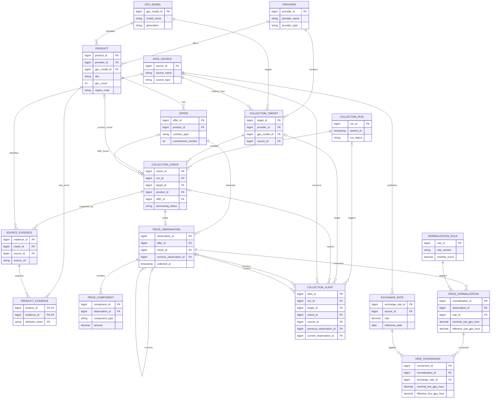

# ERD

실제 DB 기준 문서. 스키마를 바꾸면 이 문서와 `collector/src/gpu_collector/sql/ddl.sql`을 같이 고친다.

- 2026-11-16 논리 설계 초안으로 작성, 지금 DB가 이대로 구현돼 있다(2026-11-22 대조: 17개 테이블·154개 컬럼·필수 여부 일치).
- DDL에서 더한 것: 상품·오퍼 유일성(5.2절) → `UNIQUE NULLS NOT DISTINCT`, 트리거 함수 `search_path` 고정.
- 설계 근거: 요구사항 명세 v0.2(FR·DR·OR·NFR), 기능명세서 요구사항·Agent 통합본(FN·OPS, FR 연결은 v0.1 기준).

## 1. 이 설계가 답하려는 질문

담당자가 “B300의 온디맨드 공개가격을 조건별로 비교해줘”라고 요청했을 때 서비스가 다음을 확인할 수 있어야 한다.

- 어느 사업자의 어떤 상품이고 GPU·CPU·메모리·지역은 무엇인가?
- 온디맨드인지 약정인지, 원래 가격과 단위는 무엇인가?
- 어떤 출처에서 언제 수집했고, GPU당 시간당 가격은 어떻게 환산했는가?
- 상품을 찾지 못했는지, 공식 가격이 미공개인지, 수집이 실패했는지 구분할 수 있는가?
- 이전 가격과 당시 근거를 다시 확인할 수 있는가?

이를 위해 **사업자 → 상품 → 계약 조건 → 시점별 가격**을 나누고, 수집 대상·실행·점검과 출처를 별도로 연결한다. 대시보드와 Agent는 같은 데이터와 공통 계산 규칙을 이용한다.

### 범위 표시

| 범위 | 이 문서의 처리 |
|---|---|
| 공개가격 수집·비교·출처·과거 자체 관측·자동 환율 | 기본 ERD에 포함한다. 가격 원본과 이력을 보존한다. |
| 원가·후보가격·IRR | 기능에 필요한 입력·결과는 정리한다. 영구 저장 여부가 두 문서에 정해지지 않아 기본 ERD에 저장 테이블을 확정하지 않는다. IRR은 두 문서에서 잠정 MVP 필수이지만 산식·제약은 검토 중이다. |
| Agent 질문 | 공개 데이터 조회와 후속 질문 조건 유지가 필요하다. 대화의 영구 저장은 명시되지 않아 기본 ERD에 넣지 않는다. |
| 수집 알림·평가 | 알림·평가의 기록은 필요하다. 운영 DB 테이블은 하나의 제안이고, 평가 기록은 별도 저장소나 파일도 가능하다. |
| 생애 주기 비교·전기료·변동 자료 조사·외부 과거 자료 | 선택 또는 별도 검토다. 자동 수집·새 테이블이 필수인 것처럼 가정하지 않는다. |
| P&L 손익 시뮬레이션·미래가격 예측 | 두 문서의 MVP 제외 범위다. IRR 현금흐름 계산과 구분한다. |

## 2. 기능별 데이터에서 테이블을 도출하기

`FN`과 `FR`은 서로 다른 문서의 식별자다. 한 테이블을 여러 기능에서 함께 사용하며, 기능 하나마다 별도 테이블을 만들지는 않는다.

| 기능 | 필요한 데이터 | 저장 또는 이용할 테이블·필드 | 별도 계산·처리 |
|---|---|---|---|
| **FN-01 수집·재조회** / FR-01~02 | 사업자, 모델, 수집 대상·경로, 실행·성공·실패 시각 | `PROVIDER`, `GPU_MODEL`, `DATA_SOURCE`, `COLLECTION_TARGET`, `COLLECTION_RUN`, `COLLECTION_CHECK` | 가격이 같아도 수집 때마다 이력 추가 |
| **FN-02 대시보드** / FR-07~11 | 모델, 사업자 유형, 조건별 가격, 상태·표본 | `PRODUCT`, `OFFER`, `PRICE_OBSERVATION`, `PRICE_NORMALIZATION`, `COLLECTION_CHECK` | 최저·중앙·최고와 상품·오퍼·사업자·관측 수는 조회 시 계산 |
| **FN-03 단위·원화 환산** / FR-12~16 | 원본 금액·통화·시간 단위·GPU 수·선납·약정 기간, 규칙·환율 | `PRODUCT.gpu_count`, `OFFER.commitment_months`, `PRICE_COMPONENT`, `NORMALIZATION_RULE`, `PRICE_NORMALIZATION`, `EXCHANGE_RATE` | 사용자 입력 환율은 요청에서만 쓰고 저장하지 않음 |
| **FN-04 상품 비교** / FR-17~22 | 시스템 유형, GPU 수, CPU·RAM·스토리지, 연결·지역·계약 | `PRODUCT`, `OFFER`, `PRODUCT_EVIDENCE`, `SOURCE_EVIDENCE` | 동일·지역 제외·참고 비교는 공통 기준으로 판정 |
| **FN-05 약정 비교** / FR-23~24 | 계약 유형·기간·선납·최소물량, 비교 가능한 온디맨드·약정 가격 | `OFFER`, `PRICE_COMPONENT`, `PRICE_NORMALIZATION` | 할인율을 계산. 할인율만 공개된 경우의 추정가는 가정으로 별도 표시 |
| **FN-06 출처 상세** / FR-03~06 | 원본 가격·단위·원문, 공식·집계 출처, 수집 시각 | `PRICE_OBSERVATION`, `PRICE_COMPONENT`, `COLLECTION_CHECK`, `SOURCE_EVIDENCE`, `DATA_SOURCE` | 공식 원천을 확인하지 않았으면 확인됐다고 표시하지 않음 |
| **FN-07 가격 추이** / FR-25~29 | 같은 오퍼의 전후 관측·원문, 환율, 자료 공백 | `PRICE_OBSERVATION`, `PRICE_COMPONENT`, `COLLECTION_CHECK`, `EXCHANGE_RATE` | 변동액·변동률·가격/환율 효과를 계산. 원문 단위가 달라지면 구분 |
| **FN-08 공개 상태** / FR-30~33 | 공개 상태, 미발견·실패 등 처리 결과, 마지막 확인 시각 | `COLLECTION_TARGET`, `COLLECTION_CHECK`, `SOURCE_EVIDENCE` | 미공개·미발견·수집 실패를 다른 상태로 표시 |
| **FN-09~10 원가·후보가** / FR-34~39 | 항목별 비용·상태·단위·시점·출처, GPU 수·가동률·마진, 시장가격 | 비용·가정은 **요청 데이터**, 시장가격은 공개가격 테이블 조회 | 공통 계산 모듈이 원가·후보가 계산. 비교 시장가격이 없더라도 원가 계산이 가능하면 후보와 비교 불가 사유를 구분 |
| **FN-11 가격 질의 Agent** / FR-46~51·57~59 | 모델·계약·지역 등 조건, 공개가격·근거·표본 | 공통 공개가격 조회 + 제한된 대화 상태 | 조건·도구·응답을 처리. 원가·IRR 민감값은 외부 LLM 요청과 로그에 넣지 않음 |
| **FN-12 IRR** / FR-40~45 | 투자금·기간·잔존가치·목표 IRR·현금흐름·가격 | **요청·계산 결과 데이터** + 공개 시장가격 조회 | 입력·산식·제약 및 저장 여부는 확정 필요. IRR 계산에 필요한 현금흐름은 P&L 시뮬레이션과 구분 |
| **OPS-01 운영 점검** / OR-01~07 | 수집 실패·미실시·누락·이상 변동, 대상·시각·사유 | `COLLECTION_RUN`, `COLLECTION_CHECK`, `COLLECTION_ALERT` 제안 | 알림을 로그·대시보드에 남긴다. 임계값·보관 정책은 문서 간 차이 확인 필요 |
| **OPS-02 정답표·평가** / OR-08~15 | 평가 질문·기대값·실제값, 실행 버전, 판정·실패·미실시 | 별도 평가 기록. 운영 DB 테이블 또는 파일·평가 저장소 중 선택 | 분자·분모와 미실시를 보존. 서비스 대화의 영구 저장과 구분 |
| **FN-13~16 선택 기능** / FR-52~55 | 출시 근거·이전 세대 이력·전기료 입력·관련 공개 자료 | `GPU_MODEL`, 가격 이력·근거를 우선 재사용. 전기료 등은 선택 입력 | 선택 또는 별도 검토. 자동 수집과 결과 저장은 확정하지 않음 |
| **FR-56·60~67 확장** | 외부 과거 자료·상황별 도구 선택·추가 분석 후보 | 채택 시 필요한 출처·도구 실행·결과를 별도 설계 | MVP 기본 테이블이나 실제 구현으로 단정하지 않음 |

## 3. 처음 보는 사람을 위한 용어

| 용어 | 뜻 | 예시 |
|---|---|---|
| PK | 테이블의 각 행을 구별하는 고유 번호 | 상품 번호 `product_id` |
| FK | 다른 테이블의 행을 가리키는 번호 | 오퍼의 `product_id`가 어떤 상품인지 연결 |
| 상품 | 사업자가 제공하는 구성 | B300 8장, CPU·메모리 포함 인스턴스 |
| 오퍼 | 한 상품에 적용되는 계약 조건 | 같은 인스턴스의 온디맨드, 1년 약정 |
| 관측 | 특정 오퍼의 가격을 특정 시점에 확인한 기록 | 월요일에 확인한 공개 가격 |
| 수집 대상 | 찾으려는 사업자·모델·출처·범위 | 상품이 아직 발견되지 않은 사업자의 VR200 가격 |
| 출처 근거 | 수집 시 확인한 공식 페이지 또는 집계 사이트의 증거 | 원본 페이지 URL·발췌·수집 시각 |
| 명목 / 실효 단가 | 표시가격을 환산한 값 / 선납금·약정 총액 등 조건을 반영한 값 | 두 값은 필요 정보와 계산 방식이 다름 |

## 4. ERD 관계도

관계선 `||`는 하나, `o|`는 없거나 하나, `o{`는 0개 이상이다. 그림에는 주요 PK·FK만 표시하며 전체 컬럼은 5절에 있다. `COLLECTION_ALERT`는 운영 기록을 DB에 보관할 경우의 **제안 테이블**이다.

**읽는 방법:** `PRODUCT` 한 건에 `OFFER`가 여러 건이고, 한 `OFFER`에 시간별 `PRICE_OBSERVATION`이 여러 건이다. `COLLECTION_TARGET`은 상품이 발견되지 않아도 만들 수 있으며, `COLLECTION_CHECK`는 상품·오퍼가 없을 때 FK를 비워 점검 결과를 남긴다. 실제 가격을 찾은 오퍼별 점검만 가격 관측과 연결한다. 원천·집계 근거가 여러 개면 `SOURCE_EVIDENCE` 여러 행을 연결한다.

## 5. 테이블별 역할·컬럼

타입은 이해를 돕는 **논리 타입 제안**이다. `BIGINT` PK는 시스템 식별자, `DECIMAL`은 정확한 금액·비율, `TIMESTAMP`는 UTC 시각, `DATE`는 날짜, `TEXT`는 문자열을 뜻한다. `필수`는 이 초안에서 제안하는 필수값, `선택`은 미확인일 때 NULL을 허용한다는 의미다. 물리 DB의 정밀도·인덱스·문자 길이는 별도 확정한다. 금액 원문을 함께 보존한다.

### 5.1 기준 정보

#### PROVIDER — 가격을 제공하는 사업자

| 컬럼 | 타입·키 | 필수 | 설명 |
|---|---|---|---|
| `provider_id` | BIGINT PK | 예 | 사업자 식별자 |
| `provider_name` | TEXT | 예 | 사업자명 |
| `provider_type` | TEXT | 예 | 종합 클라우드 / GPU 특화 / 미확인 |
| `official_url` | TEXT | 아니요 | 사업자 공식 홈페이지 |

예: 가상 사업자 A가 GPU 특화 사업자라면 A의 상품 여러 개가 하나의 `provider_id`를 참조한다.

#### GPU_MODEL — 정규화한 GPU 모델

| 컬럼 | 타입·키 | 필수 | 설명 |
|---|---|---|---|
| `gpu_model_id` | BIGINT PK | 예 | 모델 식별자 |
| `model_name` | TEXT | 예 | 정규화 모델명 |
| `manufacturer` | TEXT | 아니요 | 제조사 |
| `generation` | TEXT | 아니요 | 세대. 확인할 수 없으면 미확인 |
| `release_date` | DATE | 아니요 | 선택 기능인 생애 주기 비교의 출시일 |
| `release_source_url` | TEXT | 아니요 | 출시일 근거. 최초 가격 관측일과 구분 |

#### DATA_SOURCE — 공식·집계·환율 출처

| 컬럼 | 타입·키 | 필수 | 설명 |
|---|---|---|---|
| `source_id` | BIGINT PK | 예 | 출처 식별자 |
| `source_name` | TEXT | 예 | 출처명 |
| `source_type` | TEXT | 예 | 공식 API·공식 페이지·집계 사이트·환율 출처 등 |
| `base_url` | TEXT | 예 | 기본 주소 |
| `collection_method` | TEXT | 예 | API·페이지·파일 등 수집 방법 |
| `terms_status` | TEXT | 예 | 이용조건 확인 상태. 허용 여부 미확인 가능 |
| `terms_checked_at` | TIMESTAMP | 아니요 | 이용조건 확인 시각 |
| `terms_url` | TEXT | 아니요 | 이용조건 근거 링크 |

자료 사용·보관 가능 여부는 이 테이블을 둔다고 자동으로 허용되는 것이 아니다. 문서 OR-02의 조건 확인을 기록하기 위한 제안이다.

### 5.2 상품과 계약

#### PRODUCT — 사업자가 제공하는 상품 구성

| 컬럼 | 타입·키 | 필수 | 설명 |
|---|---|---|---|
| `product_id` | BIGINT PK | 예 | 상품 구성 식별자 |
| `provider_id` | BIGINT FK → PROVIDER | 예 | 판매 사업자 |
| `gpu_model_id` | BIGINT FK → GPU_MODEL | 예 | 정규 모델 |
| `sku` | TEXT | 아니요 | 사업자 원본 SKU 등. 모르면 NULL |
| `original_product_name` | TEXT | 아니요 | 원본 상품명 |
| `original_model_name` | TEXT | 아니요 | 원본 모델 표기 |
| `system_type` | TEXT | 예 | 인스턴스·노드·랙스케일·미확인 |
| `service_option` | TEXT | 예 | 일반·기밀 컴퓨팅·미확인 |
| `gpu_count` | INTEGER | 아니요 | 상품당 GPU 수. 확인된 값은 0보다 큼 |
| `vram_gb_per_gpu` | DECIMAL | 아니요 | GPU 한 장당 VRAM, GB |
| `vcpu_count` | DECIMAL | 아니요 | vCPU 수 |
| `ram_gb` | DECIMAL | 아니요 | RAM, GB |
| `storage_description` | TEXT | 아니요 | 스토리지 구성·단위·포함 여부 |
| `spec_scope` | TEXT | 아니요 | CPU·RAM·스토리지의 기준: 인스턴스·노드·랙 등 |
| `intra_node_interconnect` | TEXT | 아니요 | 노드 내부 GPU 연결. 예: NVLink |
| `interconnect_status` | TEXT | 예 | 공식 근거 확인 / 미확인 / 해당 없음 |
| `inter_node_network` | TEXT | 아니요 | 노드 간 네트워크. 예: InfiniBand |
| `region_code` | TEXT | 아니요 | 사업자가 사용한 원본 리전 코드 |
| `country_code` | TEXT | 아니요 | 비교용 국가 코드 |
| `configuration_version` | INTEGER | 예 | 구성 변경을 구분하는 버전 |
| `created_at` | TIMESTAMP | 예 | 해당 구성 기록 시각 |

**식별:** v0.2 DR-05는 사업자·SKU·모델·구성 유형·서비스 옵션·GPU 수·원본 리전을 상품 키 후보로 제시한다. SKU나 구성값이 미확인이면 임의 값으로 채워 같은 상품이라고 단정하지 않는다. 구성 변경 시 기존 행을 덮지 않고 점검·버전 처리한다.

**유일성:** 사업자·정규 모델·원본 상품명·원본 리전·구성 유형·서비스 옵션·구성 버전이 같으면 한 행만 둔다. 미확인(NULL)인 값도 서로 같은 값으로 보아 중복을 막는다. SKU는 사업자에 따라 리전·계약마다 달라 상품 키에 넣지 않고, GPU 수 등 사양 값은 구성 버전으로 구분한다.

#### OFFER — 상품의 계약 조건

| 컬럼 | 타입·키 | 필수 | 설명 |
|---|---|---|---|
| `offer_id` | BIGINT PK | 예 | 오퍼 식별자 |
| `product_id` | BIGINT FK → PRODUCT | 예 | 어떤 상품의 조건인지 |
| `contract_type` | TEXT | 예 | 온디맨드·스팟·약정·미확인 |
| `contract_product_type` | TEXT | 아니요 | 예약 상품 등 계약 상품 유형 |
| `commitment_months` | INTEGER | 아니요 | 약정 기간. 확인된 값은 0보다 큼 |
| `payment_option` | TEXT | 아니요 | 선납·부분 선납·무선납 등 |
| `minimum_quantity` | DECIMAL | 아니요 | 최소물량 |
| `minimum_quantity_unit` | TEXT | 아니요 | 최소물량 단위 |
| `terms_version` | INTEGER | 예 | 계약 조건 버전 |
| `created_at` | TIMESTAMP | 예 | 해당 조건 기록 시각 |

같은 상품의 온디맨드와 1년 약정은 서로 다른 오퍼다. 계약 유형·기간·선납 방식이 불명확하면 임의로 채우지 않는다. 같은 상품에서 계약 유형·계약 상품 유형·약정 기간·선납 방식·계약 조건 버전이 같으면 한 행만 둔다(미확인 NULL도 같은 값으로 본다). **최소물량의 실효가 반영 여부는 두 문서가 다르므로 미정**이다.

### 5.3 수집과 근거

#### COLLECTION_TARGET — 앞으로 확인할 대상

| 컬럼 | 타입·키 | 필수 | 설명 |
|---|---|---|---|
| `target_id` | BIGINT PK | 예 | 대상 식별자 |
| `provider_id` | BIGINT FK → PROVIDER | 예 | 확인할 사업자 |
| `gpu_model_id` | BIGINT FK → GPU_MODEL | 예 | 확인할 모델 |
| `source_id` | BIGINT FK → DATA_SOURCE | 예 | 수집할 출처 |
| `region_filter` | TEXT | 아니요 | 조사할 리전·국가. 미지정 가능 |
| `contract_filter` | TEXT | 아니요 | 조사할 계약 유형. 미지정 가능 |
| `scope_description` | TEXT | 예 | 포함·제외 등 실제 수집 범위 |
| `scope_version` | INTEGER | 예 | 수집 범위 버전 |
| `enabled` | BOOLEAN | 예 | 수집 대상 사용 여부 |

아직 상품이나 오퍼가 없어도 대상은 등록할 수 있다. 범위가 변경되면 기존 범위의 성공·미발견 이력과 섞지 않도록 새 버전으로 관리하는 안이다.

#### COLLECTION_RUN — 한 번의 수집 실행

| 컬럼 | 타입·키 | 필수 | 설명 |
|---|---|---|---|
| `run_id` | BIGINT PK | 예 | 정기·수동 수집 실행 식별자 |
| `started_at` | TIMESTAMP | 예 | 실행 시작 시각 |
| `finished_at` | TIMESTAMP | 아니요 | 완료 시각. 실행 중이면 NULL |
| `run_status` | TEXT | 예 | 진행·성공·부분 실패·실패 |
| `trigger_type` | TEXT | 예 | 정기·수동·재시도 |
| `collector_version` | TEXT | 아니요 | 수집 코드 버전 |
| `failure_reason` | TEXT | 아니요 | 실패 요약. 비밀값은 남기지 않음 |

개별 대상 실패가 다른 대상의 성공 기록을 지우지 않도록 점검 결과는 아래 테이블에서 따로 남긴다.

#### COLLECTION_CHECK — 대상·상품·오퍼별 점검 결과

| 컬럼 | 타입·키 | 필수 | 설명 |
|---|---|---|---|
| `check_id` | BIGINT PK | 예 | 점검 식별자 |
| `run_id` | BIGINT FK → COLLECTION_RUN | 예 | 어느 실행에서 확인했는지 |
| `target_id` | BIGINT FK → COLLECTION_TARGET | 예 | 어떤 범위를 확인했는지 |
| `product_id` | BIGINT FK → PRODUCT | 아니요 | 상품을 확인했을 때 연결 |
| `offer_id` | BIGINT FK → OFFER | 아니요 | 오퍼를 확인했을 때 연결 |
| `check_scope` | TEXT | 예 | 대상 범위 / 상품 / 오퍼 점검 |
| `checked_at` | TIMESTAMP | 예 | 점검 시각 |
| `disclosure_status` | TEXT | 예 | 공개가·견적 문의·로그인 필요·가격 미공개·미확인 |
| `processing_status` | TEXT | 예 | 성공·경로 미지원·미발견·수집 실패·검증 실패 등 |
| `scope_completed` | BOOLEAN | 예 | 대상 범위의 점검 완료 여부 |
| `reason` | TEXT | 아니요 | 실패·미발견·검증 실패 사유 |
| `deduplication_key` | TEXT | 예 | 같은 결과 재처리 시 중복 방지 키. 생성 기준은 협의 |

대상 범위의 점검은 상품·오퍼가 없어도 된다. 상품 점검은 상품만, 오퍼 점검은 해당 상품과 오퍼를 연결한다. 오퍼의 상품·사업자·모델과 대상 범위가 서로 일치하도록 검증한다. **성공적으로 범위를 확인했을 때만 미발견으로 판정**하고, 요청 실패를 공식 미공개로 바꾸지 않는다. 이전에 관측했던 오퍼의 미발견은 동일 범위의 완료된 수집과 이전 오퍼를 대조한 뒤 해당 오퍼 점검으로 기록하는 방안이다.

#### SOURCE_EVIDENCE — 점검 당시의 출처 근거

| 컬럼 | 타입·키 | 필수 | 설명 |
|---|---|---|---|
| `evidence_id` | BIGINT PK | 예 | 근거 식별자 |
| `check_id` | BIGINT FK → COLLECTION_CHECK | 예 | 근거가 연결된 점검 |
| `source_id` | BIGINT FK → DATA_SOURCE | 예 | 해당 근거의 출처 |
| `evidence_role` | TEXT | 예 | 공식 원천 / 집계 / 사양 근거 등 |
| `source_url` | TEXT | 예 | 당시 확인한 세부 URL |
| `source_version` | TEXT | 아니요 | API·문서 등 원본 버전 |
| `excerpt` | TEXT | 아니요 | 허용 범위 내 원문 발췌 |
| `primary_verified` | BOOLEAN | 아니요 | 집계값의 공식 원천 확인 여부. 모르면 NULL |
| `verified_at` | TIMESTAMP | 아니요 | 실제 공식 원천 확인 시각 |
| `captured_at` | TIMESTAMP | 예 | 해당 근거 수집 시각 |

한 점검에 공식 원천과 집계 사이트를 각각 연결할 수 있다. 수집 당시 원문 저장·재배포는 출처별 조건을 확인한다.

#### PRODUCT_EVIDENCE — 상품 사양과 근거를 연결

| 컬럼 | 타입·키 | 필수 | 설명 |
|---|---|---|---|
| `product_id` | BIGINT PK, FK → PRODUCT | 예 | 사양이 속한 상품 버전 |
| `evidence_id` | BIGINT PK, FK → SOURCE_EVIDENCE | 예 | 사양을 뒷받침한 근거 |
| `attribute_name` | TEXT PK | 예 | GPU 수, 노드 내 상호연결 등 사양명 |

복합 PK는 세 컬럼을 함께 사용한다. v0.2 DR-07의 노드 내 상호연결은 공식 근거가 있을 때만 확인으로 판정한다. GPU 1장에 적용되는 ‘해당 없음’과 미확인을 구분한다.

### 5.4 가격·환산·환율

#### PRICE_OBSERVATION — 오퍼 가격의 시점별 관측

| 컬럼 | 타입·키 | 필수 | 설명 |
|---|---|---|---|
| `observation_id` | BIGINT PK | 예 | 관측 식별자 |
| `offer_id` | BIGINT FK → OFFER | 예 | 가격을 확인한 오퍼 |
| `check_id` | BIGINT FK → COLLECTION_CHECK | 예 | 해당 오퍼 점검 |
| `collected_at` | TIMESTAMP | 예 | 실제 가격을 수집한 시각 |
| `effective_from` | TIMESTAMP | 아니요 | 사업자가 명시한 가격 적용 시각. 불명이면 NULL |
| `price_certainty` | TEXT | 예 | 확정가·시작가·범위·추정 등 |
| `raw_price_text` | TEXT | 아니요 | 금액·단위·범위의 원본 표기 |
| `original_currency` | TEXT | 아니요 | 원본 통화 |
| `original_time_unit` | TEXT | 아니요 | 시간·월·전체 약정 등 |
| `price_applies_to` | TEXT | 아니요 | GPU·인스턴스·클러스터 등 원본 가격 대상 |
| `raw_terms` | TEXT | 아니요 | 가격 조건의 원문 또는 요약 |
| `corrects_observation_id` | BIGINT FK → PRICE_OBSERVATION | 아니요 | 정정 시 기존 관측 |
| `correction_reason` | TEXT | 아니요 | 정정 사유. 정정 시 필수 |

관측은 추가 전용이다. 가격이 같아도 수집마다 추가하고, 정정은 이전 관측을 가리키는 새 행으로 남기는 안이다. 가격이나 할인 조건을 실제로 확인했을 때만 만든다. 미발견·실패는 `COLLECTION_CHECK`로 남기며 가격 0원을 만들지 않는다. `check_id`가 연결한 오퍼와 `offer_id`는 같아야 하며, 한 오퍼 점검에 최대 하나의 관측을 제안한다.

#### PRICE_COMPONENT — 공개 가격의 구성요소

| 컬럼 | 타입·키 | 필수 | 설명 |
|---|---|---|---|
| `component_id` | BIGINT PK | 예 | 가격 요소 식별자 |
| `observation_id` | BIGINT FK → PRICE_OBSERVATION | 예 | 어느 관측의 일부인지 |
| `component_type` | TEXT | 예 | 표시가·시간 요율·선납금·약정 총액·할인율·범위 상한/하한 등 |
| `amount` | DECIMAL | 아니요 | 원본 금액. 할인율만 있으면 NULL |
| `currency` | TEXT | 아니요 | 이 요소의 통화 |
| `time_unit` | TEXT | 아니요 | 해당 금액의 시간 단위 |
| `applies_to` | TEXT | 아니요 | GPU·인스턴스 등 적용 대상 |
| `discount_rate` | DECIMAL | 아니요 | 공개 할인율. 기준 단위와 값 범위는 구현 시 확정 |
| `raw_value` | TEXT | 예 | 수집한 요소의 원본 값·표기 |

예를 들어 선납금과 시간당 요금은 각각 다른 요소로 보존한다. 시작가·범위·할인율만 공개된 값은 확정가와 구분한다. 사용량 구간별 요율을 수집해야 한다면 구간과 단위를 추가할지 별도 검토한다.

#### NORMALIZATION_RULE — 환산 규칙

| 컬럼 | 타입·키 | 필수 | 설명 |
|---|---|---|---|
| `rule_id` | BIGINT PK | 예 | 규칙 식별자 |
| `rule_version` | TEXT | 예 | 환산 규칙 버전 |
| `monthly_hours` | DECIMAL | 예 | 월 단위 가격 환산 기준시간 |
| `formula_description` | TEXT | 예 | 시간·월·약정 등 환산 방법 |
| `precision_policy` | TEXT | 예 | 저장·화면 정밀도와 반올림 기준 |
| `created_at` | TIMESTAMP | 예 | 규칙 기록 시각 |

v0.2 DR-02·03은 월 730시간을 제시하지만 기능명세 FN-03은 720/730이 미정이라고 적었다. 구현 전 최종 기준을 합의하고 사용한 값·버전을 명시한다.

#### PRICE_NORMALIZATION — 환산 결과

| 컬럼 | 타입·키 | 필수 | 설명 |
|---|---|---|---|
| `normalization_id` | BIGINT PK | 예 | 환산 결과 식별자 |
| `observation_id` | BIGINT FK → PRICE_OBSERVATION | 예 | 원본 관측 |
| `rule_id` | BIGINT FK → NORMALIZATION_RULE | 예 | 적용한 규칙 |
| `nominal_usd_gpu_hour` | DECIMAL | 아니요 | 명목 USD/GPU·시간. 계산 불가면 NULL |
| `effective_usd_gpu_hour` | DECIMAL | 아니요 | 실효 USD/GPU·시간. 계산 불가면 NULL |
| `result_status` | TEXT | 예 | 계산 성공·계산 불가·가정 시나리오 등 |
| `reason` | TEXT | 아니요 | 환산 불가·가정 적용 사유 |
| `calculation_inputs` | TEXT | 예 | 사용한 GPU 수·가격 구성요소 ID·시간 등 공개 계산 입력의 기록 |
| `calculated_at` | TIMESTAMP | 예 | 계산 시각 |

정상 USD 가격의 환산 결과 저장을 제안한다. `calculation_inputs`의 구성요소 ID는 텍스트로만 담기므로 DB 외래키가 아니다. 저장 전 모든 ID가 해당 관측에 속하는지 검증하고 실제 사용 값·단위의 스냅샷을 함께 기록하며, 참조한 원본 구성요소를 보존해야 한다. FK로 강제할지 구성요소 연결 테이블을 추가할지는 물리 설계에서 결정한다. 같은 원본을 다른 규칙으로 계산하면 규칙과 결과를 구분한다. **할인율만 공개된 약정의 가정가격은 우선 저장하지 않고** 해당 할인율과 같은 상품의 온디맨드 기준 관측·환산 결과를 조회할 때 계산한다. 응답에 두 관측/환산 ID, 규칙·시점을 함께 제시하고 확정가 집계에서 제외한다. 시나리오를 영구 저장하기로 정하면 기준 결과 FK와 입력 버전을 추가해야 한다. 시작가·범위는 원문을 보존해 표시하고 집계에서 제외하며 범위 환산 저장 방식은 미정이다.

v0.2 MVP 기준으로 비USD 원문은 보존하되 집계에서 제외한다. 수동 환율은 이 테이블에 저장하지 않는다. 이익률이나 내부 원가는 공개가격 환산 입력에 넣지 않는다.

#### EXCHANGE_RATE — 자동 조회 환율

| 컬럼 | 타입·키 | 필수 | 설명 |
|---|---|---|---|
| `exchange_rate_id` | BIGINT PK | 예 | 자동 환율 식별자 |
| `source_id` | BIGINT FK → DATA_SOURCE | 예 | 환율 출처 |
| `base_currency` | TEXT | 예 | 기준 통화. 예: USD |
| `quote_currency` | TEXT | 예 | 환산 대상 통화. 예: KRW |
| `rate` | DECIMAL | 예 | 기준 통화 1단위당 환산 통화 값 |
| `reference_date` | DATE | 예 | 환율 기준일 |
| `collected_at` | TIMESTAMP | 예 | 환율 수집 시각 |
| `source_url` | TEXT | 아니요 | 해당 값의 근거 URL 또는 API 식별자 |

v0.2 DR-04는 한국은행 ECOS와 휴일 직전 영업일을 초안으로 제시한다. 기능명세서는 출처·API 확인이 필요하다고 하므로 최종 출처는 협의한다. 자동 환율 수집 실패는 `COLLECTION_ALERT` 또는 운영 로그에 남기고 없는 환율을 임의 대체하지 않는다. 원화 가격 변화를 분석할 때는 전후 관측과 각각 사용한 환율의 ID·기준일·출처를 `KRW_CONVERSION`에서 확인해 응답에 표시하는 안이다.

#### KRW_CONVERSION — 자동 환율을 적용한 원화 결과

| 컬럼 | 타입·키 | 필수 | 설명 |
|---|---|---|---|
| `conversion_id` | BIGINT PK | 예 | 원화 환산 결과 식별자 |
| `normalization_id` | BIGINT FK → PRICE_NORMALIZATION | 예 | 원본 USD/GPU·시간 환산 결과 |
| `exchange_rate_id` | BIGINT FK → EXCHANGE_RATE | 예 | 실제 적용한 자동 환율 |
| `nominal_krw_gpu_hour` | DECIMAL | 아니요 | 명목 원화/GPU·시간. 원본값이 없으면 NULL |
| `effective_krw_gpu_hour` | DECIMAL | 아니요 | 실효 원화/GPU·시간. 원본값이 없으면 NULL |
| `calculated_at` | TIMESTAMP | 예 | 환산 시각 |

v0.2 DR-01의 적용 환율·기준일 추적을 위해 저장하는 제안이다. 해당 USD 결과의 규칙은 `PRICE_NORMALIZATION.rule_id`에서, 환율의 출처·기준일은 `EXCHANGE_RATE`에서 확인한다. 자동 USD/KRW 환율에만 연결하고 통화 방향을 검증한다. 사용자가 직접 입력한 환율과 그 값으로 계산한 결과는 이 테이블에 저장하지 않는다(FR-16). 과거 가격 변화의 환율 분해는 각 시점에 어떤 환율을 선택했는지 표시하며 선택 기준은 팀에서 확정한다.

### 5.5 운영 기록 — DB에 둘 경우의 제안

#### COLLECTION_ALERT — 수집·가격 이상 점검 기록

| 컬럼 | 타입·키 | 필수 | 설명 |
|---|---|---|---|
| `alert_id` | BIGINT PK | 예 | 알림 식별자 |
| `run_id` | BIGINT FK → COLLECTION_RUN | 아니요 | 관련 수집 실행 |
| `target_id` | BIGINT FK → COLLECTION_TARGET | 아니요 | 관련 GPU 수집 대상. 환율 등 GPU 대상이 없으면 NULL |
| `check_id` | BIGINT FK → COLLECTION_CHECK | 아니요 | 관련 점검. 대상 점검 전 실패면 NULL 가능 |
| `source_id` | BIGINT FK → DATA_SOURCE | 아니요 | 관련 출처. 환율 수집 실패에도 사용 |
| `previous_observation_id` | BIGINT FK → PRICE_OBSERVATION | 아니요 | 변동 전 관측 |
| `current_observation_id` | BIGINT FK → PRICE_OBSERVATION | 아니요 | 변동 후 관측 |
| `alert_type` | TEXT | 예 | 급변·수집 실패·누락 등 |
| `detected_at` | TIMESTAMP | 예 | 감지 시각 |
| `rule_version` | TEXT | 아니요 | 감지에 사용한 규칙 버전 |
| `reason` | TEXT | 아니요 | 감지·실패 이유 |
| `handling_status` | TEXT | 예 | 미확인·확인 중·처리 등 |
| `deduplication_key` | TEXT | 예 | 같은 사건 중복 기록 방지 키 |

v0.2 OR-06은 직전 대비 ±30% **초과** 변동을 점검하고 로그·대시보드에 남기는 안이며, 기능명세 OPS-01은 임계값·알림 방식을 미정으로 둔다. 어떤 기준을 채택하든 기록·조회가 필요하다. 이 테이블 대신 운영 로그·별도 저장소를 쓸 수도 있으며 보존 기간은 미정이다. 스케줄러가 아예 실행되지 않은 경우는 실행 기록만으로 알 수 없으므로 예정 일정과 실행 이력을 대조하는 운영 방법을 별도로 정해야 한다.

## 6. 저장 테이블 밖에서 필요한 기능 데이터

아래는 두 문서의 기능을 수행하기 위한 **요청·응답 데이터 예시**다. 실제 원가의 저장을 결정하거나 외부 LLM에 보내라는 뜻이 아니다.

| 구분 | 필요한 값 | 다루는 방식 |
|---|---|---|
| 원가 항목 | 항목 유형, 값, 통화·단위·기간, 지역·기준일·출처, 공개 자료/사용자 입력/미반영/다른 항목에 포함 여부 | 사용자가 입력하거나 합의된 공개 자료를 선택. 미반영은 0원이 아님 |
| 원가·마진 가정 | GPU 수·가동률·상각 기간·금리·마진 방식·목표 마진·필요한 환율 | 계산 요청 시 값·범위를 검증. 가산율과 매출 기준 이익률을 구분 |
| 원가·후보 결과 | 시간당 원가·후보가격·예상 마진·계산식·누락 목록·시장 비교 상태 | 입력 가정에 따른 결과. 시장 자료 부재와 원가 계산 불가를 따로 표시 |
| IRR | 투자금·기간·잔존가치·목표 IRR·가격·기간별 현금흐름·결과 상태 | 두 문서는 잠정 필수로 두지만 목표·현금흐름·제약은 합의 필요 |
| Agent 대화 상태 | 질문에서 확인한 GPU·계약·지역·구성·후속 질문의 변경 조건 | 후속 질문을 위한 제한된 요청·세션 처리 방안. 영구 저장 여부 미정 |
| Agent 평가 기록 | 평가 질문·기대값·실제 답변·모델/프롬프트/코드/데이터 버전·도구 호출·판정·사유 | 별도 평가 파일 또는 저장소 가능. 통과·실패·실행 실패·미실시와 분모를 남김 |

민감정보 차단·로그 처리 범위는 두 문서의 FR-59·NFR-08 및 합의 사항을 따른다. 원가·IRR을 저장하기로 결정하면 접근 제한·작성자 식별·보관·삭제·버전 관리와 함께 별도 테이블을 설계한다. 직접 입력한 환율은 v0.2 FR-16에 따라 저장하지 않는다.

## 7. 데이터가 연결되는 예시

다음은 **계산을 설명하기 위한 가상 예시**이며 실제 공개가격이 아니다.

### 예시 1. 인스턴스의 온디맨드 가격을 비교하는 경우

1. `PROVIDER`에 가상 사업자 A, `GPU_MODEL`에 B300을 등록한다.
2. `PRODUCT`에 사업자 A의 **B300 8장 인스턴스**를 기록한다. CPU·메모리·지역을 확인했다면 함께 기록하고 모르면 NULL로 둔다.
3. `OFFER`에 해당 상품의 **온디맨드** 조건을 연결한다. 같은 상품의 약정은 별도 오퍼다.
4. `COLLECTION_TARGET`에 확인할 범위를 두고, `COLLECTION_RUN`과 `COLLECTION_CHECK`에 수집 실행·점검을 기록한다.
5. `SOURCE_EVIDENCE`에 원본 출처와 시각을, `PRICE_OBSERVATION`과 `PRICE_COMPONENT`에 **인스턴스당 시간당 24달러**라는 가상 원본을 기록한다.
6. `NORMALIZATION_RULE`을 적용해 `PRICE_NORMALIZATION`에 `24 ÷ 8 = 3 USD/GPU·시간`을 기록한다. 이 3달러는 CPU·메모리가 포함된 인스턴스 가격을 GPU 수로 나눈 값이다.
7. 화면과 Agent는 같은 오퍼·가격·규칙·출처를 조회한다. 이 한 건만으로 전체 시장의 대표 가격이라고 단정하지 않는다.

### 예시 2. 상품이나 가격이 없는 경우와 수집 실패

- **미발견:** 대상 범위를 성공적으로 확인했지만 상품을 찾지 못했다면 `COLLECTION_CHECK`에 미발견을 남긴다. 이때 `product_id`와 `offer_id`는 NULL일 수 있다.
- **수집 실패:** 요청이나 처리 자체가 실패했다면 수집 실패와 사유를 남긴다. 이전 성공 관측은 그대로 두고 마지막 성공 시각과 함께 보여준다.
- **공식 가격 미공개:** 공식 자료에서 상품은 있으나 가격이 공개되지 않았다는 근거를 확인한 경우에만 공개 상태를 미공개로 기록한다.

어느 경우에도 가격을 0원으로 기록하지 않고, 모델이 출시되지 않았다고 단정하지 않는다.

### 예시 3. 약정 할인율만 확인된 경우

약정 `OFFER`의 `PRICE_COMPONENT`에 원본 할인율을 기록한다. 같은 상품의 비교 가능한 온디맨드 관측을 찾으면 해당 단가와 할인율로 **가정 시나리오**를 계산한다. 기준 온디맨드 관측·환산 ID와 약정 관측 ID를 응답에 함께 표시하며, 가정값을 확정 공개가격 집계에 넣지 않는다.

## 8. 두 문서에서 다른 부분과 결정할 사항

두 문서는 모두 초안이다. 아래 차이는 ERD에서 값을 빠뜨리지 않도록 기록하되, 실제 계산·운영 기준은 팀이 정해야 한다.

| 항목 | 요구사항 v0.2 | 기능명세서 | 설계 반영·결정 사항 |
|---|---|---|---|
| 월 환산시간 | DR-02·03에 730시간 제시 | FN-03은 720/730 미정 | 규칙에 `monthly_hours`·버전 보관. 최종 값 합의 |
| 최소물량 | DR-03은 표시만 하고 단가에 미반영 | FN-03은 실효 단가에 필요한 계약 정보로 반영을 언급 | 물량·단위를 보존. 계산 반영 여부 합의 |
| 동일 조건·집계 | DR-07·08에 비교 키와 사업자 대표가격 제시 | FN-02·04는 세부 판정 키·집계 단위 미정 | 원본 사양·조건 보존. 최종 비교 키·표준 구성·집계 기준 합의 |
| 최신성 | 48시간 초과와 최근 미발견을 최신 집계에서 제외하는 초안 | FN-08은 집계 제외 기준 미정 | 점검·시각 보존. 제외 기준 확정 |
| 환율 출처 | DR-04는 한국은행 ECOS 제안 | 8절은 한국은행·한국수출입은행 출처 확인 필요라고 기재 | 자동 환율의 출처·기준일 보존. 사용 가능 API와 기본 출처 확인 |
| 계약 유형 누락 | FR-46은 온디맨드 가정 후 표시 | FN-11·8절은 필수 조건 확인·기본 가정에 대한 합의 필요 | 세션에서 적용 조건·가정 표시. 최종 기본값·추가 질문 기준 합의 |
| IRR | US-18은 MVP 필수, DR-17은 목표·제약 계산 초안 | FN-12는 잠정 필수, 계산 목표·제약은 미정 | IRR 입력·계산은 필요. 산식·시장 제약·저장 여부 확정 전 설계 변경 가능 |
| 가격 이력 | FR-28은 MVP 자체 관측, FR-56 외부 과거 자료는 확장 | FN-07은 외부 과거 자료의 우선순위 협의 | 자체 관측을 기본으로 설계. 외부 이력의 출처·시각은 채택 후 확장 |
| 이상 변동 | OR-06은 ±30% 초과 기록·대시보드 표시 | OPS-01은 임계값·알림 방식 미정 | 경고 기록 구조를 제안. 임계값·보관 기간 확정 |
| 보안·저장 | FR-59·NFR-08은 민감 원가의 외부 LLM 요청·로그 차단 | 민감정보 접근·처리 범위 별도 합의 | 원가·IRR·대화의 영구 저장 여부와 접근·보관 범위 별도 결정 |

## 9. 설계 확정 전 확인할 관계·제약

1. **상품 식별:** SKU가 없거나 사양이 불완전한 원본을 어떻게 식별하고 중복을 막을지 출처별로 확인한다. 모르는 값을 생성하지 않는다.
2. **오퍼·관측 일치:** `COLLECTION_CHECK`의 오퍼, `PRICE_OBSERVATION`의 오퍼, 해당 상품과 수집 대상 범위가 일치하도록 검증한다.
3. **수집 중복·정정:** 재시도와 서로 다른 출처 관측은 구분하고 정정 전후 값·이유를 보존한다. 중복 방지 키를 실제 원천 자료 단위에 맞게 확정한다.
4. **원문 근거:** 공식과 집계 근거를 구분하고, 노드 내부 연결 등 비교에 필요한 사양의 공식 근거를 연결한다. 원문 발췌의 보관 가능 범위를 확인한다.
5. **환산 재현:** 원본 가격 요소·GPU 수·계약 기간·규칙 버전과 자동 환율 근거로 결과를 다시 계산한다. 금액 정밀도·반올림과 최소물량 반영 여부를 확정한다.
6. **상태·이력:** 공식 미공개, 미발견, 수집 실패, 환산 불가, 이력 없음과 오래된 값을 구분한다. 대상 범위의 미실행·부분 실패·범위 변경은 미발견으로 처리하지 않는다.
7. **평가·보안:** 공통 조회와 Agent 결과를 같은 조건으로 대조하고, 평가의 실패·미실시를 기록한다. 내부 민감값이 외부 요청·관련 로그에 들어가지 않도록 검증한다.

